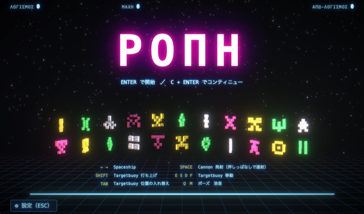
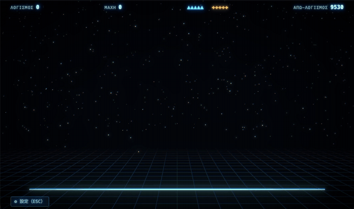

# ΡΟΠΗ

1985 年の PC-8001 用シューティングゲーム「ΡΟΠΗ」を、ブラウザで遊べるようにしたものです。
ゲームの中身（敵の動き、当たり判定、得点）は原作のままで、表示を 3D にしています。

**▶ 遊ぶ: https://jitte.github.io/react-rope/**

インストールは要りません。PC でもスマホでも、ブラウザで開くだけです。

## 遊び方

舞台は重力のある惑星です。Spaceship を左右に動かし、Cannon で ALIEN を撃ち落とします。

Cannon は重力に引かれて放物線を描きます。狙いを付けるのは Targetbuoy です。
Targetbuoy を打ち上げて動かすと、Cannon はその位置を通る軌道で発射されます。
Targetbuoy が遠すぎて届かないときは、Cannon は発射されません。

## 操作（PC）

| キー | 機能 |
|---|---|
| ← → | Spaceship |
| SPACE | Cannon 発射（押しっぱなしで連射） |
| SHIFT | Targetbuoy 打ち上げ |
| E / S / D / F | Targetbuoy 上 / 左 / 下 / 右 |
| TAB | Targetbuoy 位置の入れ替え |
| ENTER | 開始。C を押しながらならコンティニュー |
| Q | ポーズ |
| M | 消音 |
| ESC | 設定 |

設定画面で、キーの割り当て、ゲームの速さ、エフェクトの強さを変えられます。
キーの割り当てには、PC-8001 版と同じ配置の「オリジナル」も選べます。

## 操作（スマホ）

横向きで遊びます。

- **画面の右半分**: Spaceship。触れたまま左右にずらすと動きます。
- **画面の左半分**: Targetbuoy と Cannon。触れたまま上下左右にずらすと Targetbuoy が動きます。
  - 上半分から触れ始めると、動かすだけです。短くタップすると、位置の入れ替えです。
  - 下半分から触れ始めると、発射しながら動かします。
  - Targetbuoy が無いときは、触れると打ち上げます。

iPhone では、Safari の共有メニューから「ホーム画面に追加」を選び、できたアイコンから開くと全画面になります。

## 原作

「ΡΟΠΗ」は安岡孝一氏の作品です（© 1985 Kouichi Yasuoka）。
月刊アスキー 1986 年 1 月号（Vol.10 #1）に掲載されました。

## ライセンス

組み込んでいるオープンソースソフトウェアの著作権表示とライセンス文は [LICENSE.md](LICENSE.md) にあります。
